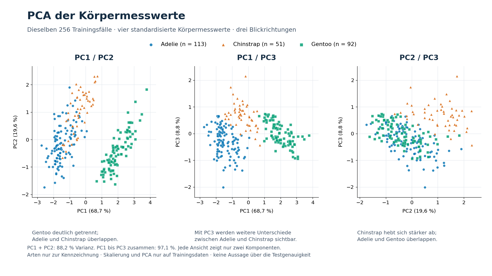

# PCA und Dublettenprüfung

## Vorgehen und Abgrenzung

Die Auswertung verwendet ausschließlich den unveränderten Referenzdatensatz `data/penguins.csv`: 344 Rohbeobachtungen, davon 342 mit vollständigen Körpermesswerten. Neue App-Beobachtungen sind nicht Bestandteil dieser Prüfung. Der ursprüngliche stratifizierte Split (Seed 42, 25 % Test) wird reproduziert: 256 Trainings- und 86 Testbeobachtungen. Die vorhandenen fünf CV-Folds liegen innerhalb des Trainingsanteils. Datensatzhash, Split und Folds stimmen mit beiden gespeicherten Modellstudien überein.

Schnabellänge, Schnabeltiefe, Flossenlänge und Körpermasse werden mit `StandardScaler` standardisiert. Skalierung und PCA werden nur auf den 256 Trainingsbeobachtungen angepasst. Die Abbildung enthält ausschließlich diese Trainingsfälle. Geschlecht, Insel und Jahr gehen nicht in die PCA ein; die Art dient nur zur nachträglichen Einfärbung. Es werden weder ein neues Klassifikationsmodell trainiert noch bestehende Modelle verändert.

## Abbildung



Die erste Hauptkomponente erklärt **68,7 %**, die zweite **19,6 %**, zusammen **88,2 %** der Varianz der standardisierten Trainingsmerkmale. Dieser Anteil ist keine Accuracy.

Die sichtbare Klassenstruktur macht die hohen Klassifikationswerte plausibel. Gentoo bildet in der ersten Ansicht (PC1/PC2) eine deutlich getrennte Gruppe; Adelie und Chinstrap überlappen teilweise. Die Grafik belegt weder fehlerfreie Trennbarkeit im Allgemeinen noch das Fehlen von Overfitting. Die PCA maximiert erklärte Merkmalsvarianz und verwendet dafür keine Artenlabels.

### Warum die dritte Komponente hilft

PC3 erklärt weitere **8,8 %**, PC4 **2,9 %**. Die ersten drei Komponenten enthalten zusammen **97,1 %** der Varianz. Das gilt für die drei Achsen gemeinsam, nicht für jedes einzelne Panel. PC1/PC3 enthält beispielsweise **77,5 %**.

In PC1/PC3 sind Adelie und Chinstrap deutlicher unterscheidbar als in PC1/PC2, mit verbleibenden Überschneidungen. PC2/PC3 hebt Chinstrap hervor, während Adelie und Gentoo stärker überlappen. Es gibt also keine einzelne hier gezeigte Projektion, die allgemein fehlerfreie Klassifikation belegt. Alle Ansichten verwenden dieselben Koordinaten und alle 256 Trainingsfälle. Eine Übersicht zeigt auch [alle sechs Komponentenpaare](pca_alle_paare.png); die [ursprüngliche PC1/PC2-Ansicht](pca_pc1_pc2.png) bleibt verfügbar.

PC3 gewichtet die standardisierte Schnabellänge mit +0,630, die Schnabeltiefe mit −0,426, die Flossenlänge mit −0,208 und die Körpermasse mit −0,615. Sie zeigt damit zusätzliche Unterschiede der Körperproportionen. Die Koeffizienten sind Richtungswerte dieser PCA und keine Merkmalswichtigkeiten des Klassifikators.

Die ergänzenden Komponenten wurden nach Sichtung der ersten Grafik zur Erklärung betrachtet. Das ist eine explorative Darstellung und keine neue unabhängige Validierung. Eine zweidimensionale Projektion lässt Information weg. Der Klassifikator arbeitet dagegen mit allen vier Körpermesswerten und zusätzlich mit dem Geschlecht; die PCA ist kein Bestandteil seiner Pipeline.

## Dublettenbefund

| Prüfung | Zeilen | Dublettengruppen | Überzählige Zeilen |
| --- | ---: | ---: | ---: |
| Vollständige Rohzeilen | 344 | 0 | 0 |
| Normalisierte Modellmerkmale (vier Messwerte + Geschlecht) | 342 | 0 | 0 |
| Nur vier Körpermesswerte | 342 | 0 | 0 |

Numerische Werte werden nicht gerundet. Für die Merkmalsprüfung werden Geschlechtsangaben getrimmt und kleingeschrieben; fehlend oder leer wird `unknown`. Die Zielvariable wird beim Merkmalsvergleich bewusst nicht berücksichtigt.

| Aufteilung | Training / Prüfung | Gleiche Modellmerkmale über Grenze | Gleiche Messwerte über Grenze |
| --- | ---: | ---: | ---: |
| Ursprünglicher Train/Test-Split | 256 / 86 | 0 | 0 |
| CV-Fold 1 | 204 / 52 | 0 | 0 |
| CV-Fold 2 | 205 / 51 | 0 | 0 |
| CV-Fold 3 | 205 / 51 | 0 | 0 |
| CV-Fold 4 | 205 / 51 | 0 | 0 |
| CV-Fold 5 | 205 / 51 | 0 | 0 |

Gezählt werden unterschiedliche identische Merkmalskombinationen, die auf beiden Seiten der jeweiligen Grenze vorkommen. Auch die Zeilenindizes sind innerhalb jeder Aufteilung disjunkt. **Es wurden keine exakten Dubletten gefunden.** Das schließt ähnliche Beobachtungen, wiederholte Messungen desselben Tiers oder andere Formen von Datenabhängigkeit und Leakage nicht vollständig aus.

## Reproduktion

```powershell
python scripts/analyze_pca_duplicates.py
```

Benötigt werden die Projektbibliotheken und Matplotlib für den statischen Export. In der vorhandenen Projektumgebung `penguin-ml` fehlt Matplotlib. Der vollständige Export wurde deshalb mit der bereits vorhandenen Anaconda-Basisumgebung erstellt (Versionen siehe JSON); es wurde nichts installiert. Auf diesem Rechner kann der Aufruf mit `& 'C:\Users\samis\anaconda3\python.exe' scripts/analyze_pca_duplicates.py` in PowerShell wiederholt werden. Die verwendeten Versionen, Dateihashes, Indizes, PCA-Komponenten, Skalierungsparameter und Einzelkoordinaten stehen in [pca_ergebnisse.json](pca_ergebnisse.json). PCA-Vorzeichen können zwischen numerischen Implementierungen gespiegelt sein; Varianz und relative Lage bleiben dabei gleich.

Für die Videoaufnahme: [pca_video.html](pca_video.html) im Browser öffnen und die PCA-Abbildung zeigen; [pca_training.svg](pca_training.svg) ist der Vektorexport.

Methodik: [scikit-learn PCA](https://scikit-learn.org/stable/modules/generated/sklearn.decomposition.PCA.html) und [StandardScaler](https://scikit-learn.org/stable/modules/generated/sklearn.preprocessing.StandardScaler.html).
